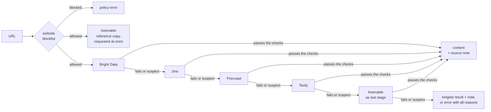

# hermes-extract-chain

A [Hermes Agent](https://github.com/NousResearch/hermes-agent) plugin that makes `web_extract` fall back across five page-fetch services (**Bright Data → Jina → Firecrawl → Tavily → Keenable**), checks each result against a second copy of the page, and tells the model where the text came from.

Hermes uses exactly one extract provider. If it fails on a page (bot protection, a consent wall, a cut-off page), the model gets an error or a bad text. Its only built-in fallback, the keyless rescue, runs when *every* URL of a call fails, and swaps in anonymous providers without saying so. This plugin registers one provider, `extract-chain`, that tries the next service per URL whenever a result fails or looks suspicious. When the result did not come straight from the first service, it adds a short note at the top of the text.

The services and their order come from a web benchmark ([docs/evaluation.md](docs/evaluation.md)); the chain's results on the stored benchmark data are in [docs/validation.md](docs/validation.md).

## How it works



Per URL:

1. **Keenable** is asked for its index copy at once, in parallel. That copy is the reference for the checks, and Keenable is the last stage.
2. The stages run in order: **Bright Data** (live, Web Unlocker), **Jina Reader** (live), **Firecrawl** (live), **Tavily Extract** (copy), **Keenable** (index copy). A stage without its key is skipped.
3. Each result is classified: an error, an empty page, a bot-check page or a consent wall moves on to the next stage. A paywall ends the chain with a note; no further provider is asked.
4. A result that looks fine is checked. It is *suspect* if it is very short, a print view, a short page with a JavaScript or bot-check hint, a short page full of consent text, or if Keenable's copy is at least 1.5 times as long. A suspect result is kept, and the next stage is asked.
5. The first result that passes is returned. If none passes, the longest kept result is returned with a note; otherwise a consent-wall or bot-check page with a note; otherwise one error listing every reason, e.g. `Bright Data: target HTTP 403; Jina: target HTTP 403; Firecrawl: target HTTP 403; Tavily: failed; Keenable: Gateway timeout`.
6. If two live stages report the page as gone (404/410) before Firecrawl was asked, no further live stage is asked; Keenable's copy is returned with a note, if it has one.

Each provider is asked at most once per URL; URLs of one call run concurrently. Rules in detail: [design.md, section 5](docs/design.md#5-chain-per-url).

Example of what the model sees:

```text
[extract-chain] Live fetch via Jina (Bright Data: shorter than the reference copy).

# Article title
…
```

## Requirements

- Hermes Agent ≥ 0.21, tested with v0.21.6.
- Keys for the page-fetch services. Every stage is optional: a stage without its key is skipped, and the plugin reports itself available as long as Bright Data, Firecrawl, Tavily or Keenable can run.
  - [Bright Data](https://brightdata.com) Web Unlocker: an API key and the name of a Web Unlocker zone created in Bright Data's control panel.
  - [Jina Reader](https://jina.ai/reader/): works without a key at 20 requests per minute; a key raises the limit.
  - [Firecrawl](https://firecrawl.dev): scraping API with a browser and proxies.
  - [Tavily](https://tavily.com): Extract API.
  - [Keenable](https://keenable.ai): search index that serves stored copies of pages. Without it, the reference check is off.
- Network access to `api.brightdata.com`, `r.jina.ai`, `api.firecrawl.dev`, `api.tavily.com` and `api.keenable.ai` (HTTPS; `HTTPS_PROXY` is honoured).

No extra Python packages: the plugin only uses `httpx`, which ships with Hermes.

## Installation

**Manual (recommended):** copy the directory `extract_chain/` as `plugins/extract-chain/` into your Hermes home.

| Setup | Target directory |
|---|---|
| Linux / macOS | `$HERMES_HOME/plugins/extract-chain/`; the Hermes home is usually `~/.hermes` |
| Official Docker image | `/opt/data/plugins/extract-chain/` (`/opt/data` is the mounted Hermes home) |
| Hermes Desktop (Windows), per profile | `%LOCALAPPDATA%\hermes\profiles\<profile>\plugins\extract-chain\` |

```bash
git clone https://github.com/Pressimize/hermes-extract-chain.git
cp -r hermes-extract-chain/extract_chain "${HERMES_HOME:-$HOME/.hermes}/plugins/extract-chain"
```

Then enable it in the profile's `config.yaml` (user plugins are opt-in) and select it:

```yaml
plugins:
  enabled:
    - extract-chain          # add to your existing entries
web:
  extract_backend: extract-chain
  keyless_rescue: false      # otherwise Hermes silently replaces fully failed calls
  extract_timeout: 180       # Hermes' default is 120; the chain needs up to 170 s per URL
```

`web.extract_timeout` bounds the whole call, and Hermes discards every result of a call that exceeds it. The plugin gives each URL `web.extract_timeout` minus 10 s, at most 170 s, and skips a stage when less than 10 s are left. Below 120 s it logs a warning.

Put the keys into the profile's `.env`:

```bash
BRIGHTDATA_API_KEY=...
BRIGHTDATA_UNLOCKER_ZONE=...   # name of your Web Unlocker zone
JINA_API_KEY=...               # optional
FIRECRAWL_API_KEY=...
TAVILY_API_KEY=...
KEENABLE_API_KEY=...
# EXTRACT_CHAIN_ORDER=brightdata,jina,firecrawl,tavily,keenable   # optional, see Configuration
```

Restart Hermes (or the gateway).

**With Hermes' installer:** Hermes can install a plugin from a Git subdirectory and asks for the keys:

```bash
hermes plugins install Pressimize/hermes-extract-chain#extract_chain --enable
```

It clones only the `extract_chain` subdirectory, asks for the required values (four keys and the zone) and enables the plugin. `JINA_API_KEY`, `EXTRACT_CHAIN_ORDER` and the `web:` settings above still go in by hand. Enabling through Hermes' CLI also syncs Hermes' package environment. The plugin needs no packages, but the manual route avoids that step entirely, which can matter in containers built from the official image. The manual route is the one we tested.

**Check:** let the agent read a page. `logs/agent.log` in the Hermes home then shows a line per URL:

```text
extract-chain www.example.com: brightdata=ok keenable=ref_ok
```

## Configuration

| Setting | Where | Value |
|---|---|---|
| `web.extract_backend` | `config.yaml` | `extract-chain` |
| `web.keyless_rescue` | `config.yaml` | `false` |
| `web.extract_timeout` | `config.yaml` | `180` |
| `EXTRACT_CHAIN_ORDER` | `.env` | optional; comma-separated stage names, default `brightdata,jina,firecrawl,tavily,keenable` |

`EXTRACT_CHAIN_ORDER` accepts exactly `brightdata`, `jina`, `firecrawl`, `tavily` and `keenable` (case and spaces do not matter). A stage left out is not used. Keenable always runs last, wherever it stands and even when it is left out, because its copy is the reference for the checks. Unknown or repeated names are dropped with a warning; if no stage but Keenable is left, the default applies. Example, Jina first: `EXTRACT_CHAIN_ORDER=jina,brightdata,firecrawl,tavily`.

## Update and uninstall

- **Update:** replace the `plugins/extract-chain/` directory with the new `extract_chain/` and restart Hermes. After a Git install, use `hermes plugins update extract-chain`. Breaking changes per release, including the upgrade from 0.2: [CHANGELOG.md](CHANGELOG.md).
- **Uninstall:**
  1. Delete `plugins/extract-chain/`.
  2. Remove `extract-chain` from `plugins.enabled`.
  3. Set `web.extract_backend` back to your previous provider.
  4. Restart Hermes.

## Notes the model may see

Every note is one line at the top of the text, starting with `[extract-chain]` (not repeated in the table). Conditions and order: [design.md, section 7](docs/design.md#7-notes-for-the-model).

| Note | Meaning |
|---|---|
| `Live fetch via <Provider> (<reasons>).` | An earlier stage failed or was suspect; the text is a live fetch of a later stage |
| `Copy via <Provider>; it may be older than the live page (<reasons>).` | The text is a copy from Tavily or Keenable |
| `Paywall indicators found; the text is probably only the free teaser.` | Paywall markers found; no further provider is asked |
| `No source passed the checks; this is the longest result (<Provider>, <n> characters; <reasons>).` | Every result failed or was suspect; the longest one is returned |
| `The live page returned HTTP <status>; this is an older copy from Keenable's index.` | Two live stages report the page as gone (404/410); Keenable still had a copy |
| `Consent wall detected; no alternative source found (<reasons>). The text below is the consent page.` | Only a consent page could be fetched |
| `This looks like a bot-check page; no other source had the page (<reasons>). The text below is what the site returned.` | Only a bot-check page could be fetched |
| `PDF cut to the first <n> of <total> pages (Firecrawl page cap).` | A long PDF came via Firecrawl |
| `The site redirected to <final_url>; the text below is from that page.` | The page came from another host or a home page (only Firecrawl and Keenable report this) |

`<reasons>` names each stage passed over, with its error or the check that applied, e.g. `Bright Data: shorter than the reference copy`, `Jina: very short page (312 characters)`, `Firecrawl: target HTTP 403`.

## Privacy

Every URL that passes Hermes' blocklist is sent to **Keenable** (the reference copy) and to the **first stage** of the order, which is **Bright Data** by default. Depending on the outcome, it also goes to **Jina**, **Firecrawl** and **Tavily**. The services see the full URL, query string included. Hermes refuses URLs that contain secrets it recognises before any provider sees them. To keep URLs away from a service, leave it out of `EXTRACT_CHAIN_ORDER` (Keenable: leave out its key).

## Costs and quotas

| Provider | Asked | Free allowance | Billing |
|---|---|---|---|
| Bright Data | every URL (default order) | 5,000 requests/month for new accounts, shared with Bright Data's other products, no carry-over | 1 request per URL; only successful requests are billed |
| Jina | when Bright Data fails or is suspect | without a key free at 20 requests/min; a new key comes with 10 million tokens | tokens of the returned text; failed requests are not billed |
| Firecrawl | when Bright Data and Jina fail or are suspect | see [evaluation.md](docs/evaluation.md#free-tiers-and-costs-vendor-pages-2026-10-09) | 1 credit per page, also for target 403/404 pages it returns; PDFs 1 credit per page, capped at 30 pages |
| Tavily | when the live stages fail or are suspect | 1,000 credits/month | `extract_depth: advanced`: 2 credits per 5 successful URLs; failures are free |
| Keenable | every URL (reference copy) | 100,000 requests/month, search and fetch combined | 1 request per URL |

Vendor terms as of 2026-10-18; check the vendors' pages before relying on them.

- For a hard cost cap, add no payment method at Bright Data, keep Firecrawl auto-recharge and Keenable auto top-up off, and set a low pay-as-you-go limit at Tavily. When a provider's API reports a used-up quota, the chain moves on, and that stage is skipped for 24 hours (`paused` in the log; pause rules: [design.md, K7](docs/design.md#5-chain-per-url)).
- Without KYC, Bright Data refuses government sites and paths blocked by robots.txt; the other stages fetch those.
- Watch usage in the log:

  ```bash
  grep -oE "(brightdata|jina|firecrawl|tavily)=[a-z_0-9]*" logs/agent.log | sort | uniq -c
  ```

## Limitations

- **Paywalls are not bypassed.** Many paywalled teasers carry no marker; they are returned as normal text.
- **Keyword and length rules.** Wall, paywall and bot-check detection uses marker phrases tuned on German news sites; the checks use lengths and Keenable's copy. A partial result that passes every check ends the chain.
- **Copies** (Tavily, Keenable) can be older than the live page; the note says so.
- **No final URL** from Bright Data, Jina and Tavily: redirects through them are not noted, and the blocklist sees only the input URL.

The full list: [design.md, section 13](docs/design.md#13-known-limitations). Edge cases and failure behaviour: [docs/troubleshooting.md](docs/troubleshooting.md).

## FAQ

**Can I change the order of the providers?**
Yes, with `EXTRACT_CHAIN_ORDER` ([Configuration](#configuration)). Keenable stays last, because its copy is the reference for the checks and it reports its own failures worst. Bright Data first gave the most complete results in the benchmark; Jina first was close and faster ([design.md, D27](docs/design.md#14-decisions)).

**Can I add another provider?**
Not without code. Each stage needs a fetcher that turns the provider's reply into text, a target status and an error code, and the rules were measured with these five.

**Why is Keenable asked for every URL?**
Its copy is what the checks compare against: a live result much shorter than the copy is probably cut off. The request runs in parallel and costs no time; Keenable's free allowance is large.

**Why not reuse Hermes' built-in Firecrawl, Tavily and Keenable providers?**
Hermes' Firecrawl provider needs the `firecrawl-py` SDK, which Hermes installs on first use. Calling the REST APIs directly needs nothing extra and gives control over timeouts, freshness and PDF limits.

**Does it apply Hermes' website blocklist?**
Yes. Hermes leaves this check to each provider. The plugin checks every URL before any request, and the final URL where a provider reports one. If a Hermes update ever moves the blocklist module, the plugin refuses every URL with a clear error instead of fetching without the blocklist.

**Does it do web search?**
No. `web.search_backend` is unaffected.

## Development

```bash
uv sync                                   # Python >= 3.11, httpx as in Hermes
uv run ruff check && uv run ruff format --check
uv run pytest
```

| Path | Content |
|---|---|
| `extract_chain/` | The plugin: `provider.py` (Hermes interface, order, budget, pauses), `chain.py` (classification, checks, chain, notes), `fetchers.py` (REST clients) |
| `tests/` | Unit tests without network (`httpx.MockTransport`; Hermes is stubbed in `conftest.py`) |
| `scripts/replay.py` | Maintainer only: replays the chain on stored single-provider results of the web benchmark; needs the raw page texts, which are not published |
| `scripts/live_check.py` | Calls Hermes' real `web_extract` path in a test profile, without an LLM and with rate limiting |
| `docs/` | [evaluation](docs/evaluation.md) (provider choice), [design](docs/design.md), [validation](docs/validation.md), [troubleshooting](docs/troubleshooting.md), `reviews/` |
| `data/` | Test data of v0.1–v0.2 without article texts: URL lists and per-URL results as CSV |
| `.github/workflows/ci.yml` | CI: ruff and pytest on Python 3.11 and 3.14 |
| `CHANGELOG.md` | Changes per release |

`pyproject.toml` only configures the tooling. It sits at the repository root on purpose: Hermes treats a plugin directory that contains a `pyproject.toml` as a package-manager member.

## Authors

- [Pressimize](https://github.com/Pressimize): idea, requirements and decisions.
- Claude, Anthropic's AI model, working in Claude Code: design, code, tests, evaluation and documentation.

## License

[MIT](LICENSE)
